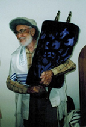

# Don and Judaism

Don was born a Jew, attended Sunday School, and had a Bar Mitzvah. He had friends who went to fight fought in the 1948 war between Israel and the Arabs, and he considered joining the Israeli military himself. He only gave any thought to the content of Judaism, however, because of the many hours he spent with his father-in-law, a Conservative Rabbi. The two of them spent many hours over a number of years discussing whether a Jew had to believe in God, whether the rituals were alive today, and the effect of the Holocaust on the survival and continuation of Judaism.

Don always defined himself as an "agnostic with atheist tendencies". He made sure his children were educated in the Jewish tradition, although he had little involvement himself. As time went on, however, and after many discussions, he came to believe that the most effective way for Judaism to continue in America was with strong synagogues that provided community, education, and an understanding that the ethical traditions provided the best guide to living your life.

He was a founding member of Congregation Beth Emek in the Livermore Valley, and over time became a very active participant in the congregation.

He provided wise counsel to the leadership, and made his particular skills available whenever there was a need.

## Related Documents

- [Congregation Beth Emek President's statement about Don Miller](../appendix/beth-emek-statement.md) - Statement to the Board shortly after his death
- [Drawing Near to God](../appendix/drawing-near-god.md) - Document Don prepared for a debate in 2010
