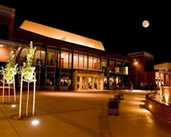
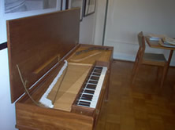

# Don and the Arts

Don loved music. He played the piano, the harpsichord and the clavicord. He also believed that music, art, drama, and other cultural activities helped make citizens proud of their community.

## Cultural Arts

Soon after arriving in Livermore, he joined the Community Concert Association, whose mission was to help bring musical programs to the City. Ten years later, in 1966, Don and four other activists wanting to generate more public support for the arts submitted a proposal to the City and the Parks District to form an Arts Council. A simple idea, it immediately created political uproar. What agency should be in charge? Would independent groups be required to join? Would taking public money mean public control of the arts? The activists, including Don, decided to stay in the background as much as possible. The time was right, though, and in a few months the Livermore Cultural Arts Commission was set up. Don served on the Board for the over 40 years.

## Music

Don's particular interest was in bringing music events to Livermore. He joined the Board of Del Valle Fine Arts, which succeeded the Community Concerts Association. For more than 40 years, these groups brought a wide variety of world class concerts to town. They also arranged for many of their artists to visit the local schools, as well as providing students with low cost tickets to the concerts.

1969 was Livermore's Centennial. Requests went out for a piece of music in honor of the City. Don, who had never written music, decided to give it a try. His composition, Centennial Rag, became the Centennial's official musical theme. A copy is included in the container of city artifacts buried by the City in Centennial Park. Don went on to write two more rags: Nostalgia Rag in 1971 and Political Rag in 1975, dedicated to the Independent Newspaper.

**Musical Compositions:**
- [Centennial Rag (PDF)](../appendix/crag.pdf)
- [Nostalgia Rag (PDF)](../appendix/nrag.pdf)
- [Political Rag (PDF)](../appendix/prag.pdf)

In the 1973, Don's daughter Lynne, who was 15 at the time, decided that she and her father should build a clavichord from a kit. As Don told the story, Lynne built the cabinetry, Don strung the clavichord, and Miriam did the "finishing." As was his custom, Don read the instructions that came with the kit in great detail before he would let Lynne pick up a tool to start, even though Lynne had already figured it out right away. But she waited patiently until Don was ready to move ahead.
