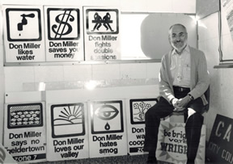
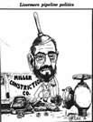
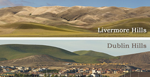

# Don Miller and Local Politics

Don first ran for City Council in 1962. He came in fifth out of eight (for three positions) with campaign ads that featured his daughters saying "If we were old enough to vote, we would vote for Don Miller." By 1968, he felt the time was right to try again, and so six months before the election, he went to Dana McGough the editor of the local newspaper, the Independent, who had experience in a number of successful campaigns. Dana's first question was: "Do you know 100 people who will support you? If you find that support, I'll show you how to win." Miriam and Don went to Carmel for the day, sat on the beach, and made a list of 100 people they knew from Cask and Mask (the local amateur theater group), the arts community, the schools, neighbors, friends, etc. Then Don went home and called each one of them.

Don had been attending Council meetings regularly, often speaking out on issues he cared about. He knew what kind of city he wanted to live in, and was always thinking about how to achieve his vision. He had been getting coverage in the local newspapers and local residents were becoming familiar with his vision for Livermore.

Although a local candidate had recently been successful knocking on doors, Don decided to organize a large precinct campaign, which no one had done before in Livermore. He limited contributions to $10 a person, and said he would not accept money from developers or the Chamber of Commerce. He won the election easily. And four years later, he was reelected by a large majority, helped in part by hundreds of silk screened signs designed in black and white by Gloria Taylor, a local artist. These signs were works of art and people saved them after the campaign.

After his two Council terms, Don continued to attend and speak at Council meetings as a citizen, and to promote his vision.

## Signs and Zoning

Don believed that people should be proud of how their city looked. He had never liked the commercial and storefront signs everywhere downtown, each trying to outdo the next for attention. Don's philosophy on signs was, "When no one shouts, everyone can be heard." He looked everywhere he went for models that would identify business in a quiet way and that would be fair to all. This was not popular with the business community, and with great difficulty, he finally convinced a majority of the Council to pass the Sign Ordinance, which limits the size and locations of signs. Much of this still exists today.

Don also believed that there was plenty of land, cities should not crowd people together just so developers could make more money. He wanted to change the zoning ordinance so that developers would have to offer more than just 5000 sq. ft. lots. This battle went on for many years, and Don eventually was successful in developing a Residential Zoning Ordinance.

## Park Development

Neighborhood parks were another part of Don's vision for a livable city. The fight for parks was made more difficult because parks were not handled by the city, but by another agency (LARPD). How to solve this? Don asked a friendly Planning Commissioner to recommend a deal whereby the City would institute a Park Development fee to buy land, and LARPD would operate the parks. Don was ecstatic when the Council finally agreed. He did not care that he got no credit for pushing this. He just wanted the parks, not the glory.

## SAVE (Save All Valley Environments)

Livermore was growing so fast in the late 1960's and 1970's that it was running out of sewers and water, and the schools were on double sessions. The developers were building houses at a great rate, and paid no attention to the resulting problems. A small group of citizens, including Don, proposed an initiative to limit construction of new houses until the sewer, water, and school problems were solved. It was very controversial, but the Initiative won. Developers challenged the SAVE Initiative in court. After a series of appeals, the California Supreme Court let the Initiative stand. This case, Associated Home Builders v. Livermore, is still discussed in California law schools.

## UGB (Urban Growth Boundary)

To preserve open space, and to limit population growth of Livermore to a sustainable level, activists, including Don, developed an Initiative in 2002 to establish a geographical boundary beyond which no development could take place. Despite opponents outspending many times over, the initiative passed overwhelmingly. A separate county-wide vote put a similar County UGB in place, and that Initiative also passed easily. The UGB stands as law and can only be overturned by another vote of the people.

## Scenic Corridor

Don's vision for Livermore and the surrounding Valley included preserving the beautiful hills surrounding the City. He believed promoting infill development which would mean houses and businesses should be built within the City limits and not disturb our hills. Don spent many hours at City Council meetings trying to convince the Council that the hills were part of our heritage and worth preserving. A protective ordinance was ultimately passed, although the fight to maintain the hills is still ongoing. But today, if you drive down hwy. 580, it is easy to see where the Dublin hills end, and Livermore hills begin.

---

## Don Miller's Political Slogans

*Collected November 1997*

*(all with * are original with DGM)*

### All generalizations (slogans) are false.

### Gratuitous Generalities

* Cynicism and pessimism are the only true guides to reality.
* In politics, a logical argument will get you nowhere.
* Something good takes years of slogging through quicksand; Anything rotten is done irreversibly in a microsecond.
* You can't win them all, or even hardly any.
* Lose a few, lose a few.
* The world is mean and man uncouth, and sad to say I tell the truth. (Bertold Brecht, Three Penny Opera)
* In politics, if you let George do it, don't bend over. (He will give you the shaft.)
* Eternal vigilance is the price of liberty.
* There is an old political theory which says that the people get precisely what they deserve.
* Greed is the most powerful of human emotions, even more so than hunger or sex.
* If the public really understands the issue, they will do the "right" thing almost every time-----unless it involves bigotry; in which case they will do the "wrong" thing every time.
* When large amounts of money are at stake, "good faith", "honest", "truth", and "trust" are words utterly without meaning.

### Philosophy and Process

* Public officials seldom act, they react.
* Politics is the art of compromise; but you never compromise if you don't have to.
* Politics is the art of the possible---but don't give up before you even start. (You can't stop growth if you start out by conceding that growth can't be stopped.)
* Every question has two sides--but NOT necessarily of equal weight.
* Whoever controls the first draft is 10 steps up the ladder.
* Whenever the details of a bad proposal begin to be discussed, the cause is lost. (Therefore decide first whether it is good or bad).
* Every public official should have a tinge of paranoia. It is of course not true that every applicant is out to screw the public. However if you make that assumption, you will be right a hell of a lot more often than you will be wrong.
* Monday night (meeting night) is masochism night.
* Personal survival in politics depends on expecting to lose everything; any win is then pure, beautiful gravy.
* The name of the game is 3 votes. (More generally, Integer((n/2)+1) votes, where n is the number of board members. For California cities, n=5.)
* The first motion often wins the day. (Many people don't like to vote no.)
* In politics, you reward your friends and punish your enemies. Consequently if you find yourself being punished by your "friends", it is time to relabel who are friends and enemies.
* In politics you don't get mad, you just get even.
* "No decision" is itself a decision.

### Who Wins; Who Loses

* Businessmen don't run the City like a business, they run it for business.
* In most political decisions, the powerful few make a bundle by taking small amounts out of the pockets of the powerless many. (Harlan Zodtner)
* To most politicians, one businessman, subdivider, or applicant is more important than 20,000 citizens.
* Consciously or unconsciously, most public officials see themselves as judges and mediators between applicants and their citizens. But they are elected to represent their citizens; let the courts be the judges.
* If politicians bend over backward to be "fair" to an applicant, they are leaning away from their constituents--and the community loses its rights.
* Developers planned (insert name of city), not its council, planners, or citizenry.
* To watch local government deal with land development issues is to view the continuous example of the triumph of private greed over public need.
* In local politics, the lines are usually drawn between the ineffective 90% of citizens who do their living in the city and the powerful 10% of businessmen, developers, and politicians who make their living from the city.
* Citizens may be equal at the polls where little is decided, but they are not equal at the bank teller's wickets where much is decided. (Ferdinand Lundberg, America's 60 Families.)
* Those who cannot remember the past are condemned to repeat it. (Santayana)
* Those who cannot remember Los Angeles or San Jose are condemned to repeat Los Angeles and San Jose.
* Contrary to popular opinion, many public officials don't take money under the table. However:
  1. Politicians can be corrupted by power, flattery, cocktail parties, and simply by desire to associate with the rich.
  2. "You cannot hope to bribe nor twist, Thank God, the British journalist. But seeing what the man will do Unbribed, there's no occasion to." (Humbert Wolfe)
* If you poison someone's coffee with cyanide, you are a vicious criminal. If you poison someone by adding arsenic to his orange juice for six months, you are a vicious criminal. If, on the other hand, your actions over a five year period poison 150,000 people's water supply, poison their air with smog, gridlock their streets and highways, and increase the per capita crime rate, you are a "far sighted" developer or politician. As such, you are to be commended for bringing "progress" to your sickened victims, to be defended by newspapers from their protests, and to be deserving of huge financial rewards.
* The ticket seller who deliberately sells a 16th ticket to a person to ride down a 15 person elevator, thereby sending all 16 hurtling to their deaths, is a vicious criminal. The elevator operator that deliberately allows it to happen is a criminal accomplice. In a smog ridden and traffic choked area where population growth inevitably makes the situation worse, the developer is the ticket seller and the City Council is the elevator operator--even if the disaster occurs more slowly. The cases differ only in degree, not in kind.
* Understanding the complicated world of politics and politicians is simple, just FOLLOW THE MONEY.

### A Few More

* Winning is better than losing.
* A man convinced against his will, is of the same opinion still. Therefore replace him by electing someone with the right gut reactions.
* A "balanced" board never accomplishes a damn thing. Therefore elect a solid majority going the same way. (However unanimity often leads to mistakes--one opposition voice keeps everyone honest.)
* Someone has to care; If you don't, who will?
* My father taught me that "Justice always triumphs," but I've found that it usually needs a lot of help.
* If every citizen of (insert name of city) were condemned to attend six City Council meetings in a row, things would be a hell of a lot different and a hell of a lot better. (And most Council members would be recalled).
* When in doubt, turn them out.
